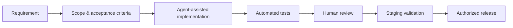

# AI-assisted software engineering

[← Back to profile](../README.md) · [🇧🇷 Português](./pt-br/ai-engineering.md)

| | |
| --- | --- |
| **Focus** | Using AI coding agents to deliver faster without lowering engineering standards |
| **Tools** | AI coding agents · MCP · local LLM inference · GitHub · CI (GitHub Actions, CircleCI) |

## Approach

I treat AI agents as part of a controlled engineering process, not as a replacement for it. Every agent task starts with a clear requirement and ends with evidence that a person can review.

## Practices

1. **Planning:** break problems into small, reviewable changes with explicit acceptance criteria.
2. **Assisted execution:** connect agents to repositories and authorized tools through MCP.
3. **Local models:** use local LLM inference for automation where privacy or cost requires it.
4. **Quality gates:** lint, type checks, tests and builds run locally first; CI confirms the final commit.
5. **Cost-aware CI:** group pushes, avoid redundant runs and save heavy pipelines for the commits that need them, while keeping all required checks.
6. **Release control:** merges, deployments and migrations need explicit approval; staging validation is not replaced by local tests.

## Principles

- AI output is not trusted until it is verified.
- Results must be reproducible and reviewable.
- User data stays intact and isolated.
- Metrics are published only when they can be backed by evidence.
