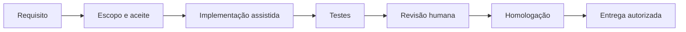

# Engenharia de software com inteligência artificial

[← Voltar ao perfil](../README.md)

## Abordagem
Uso agentes de IA e automações como ferramentas dentro de um processo de engenharia controlado, com requisitos, revisão, testes e critérios de aceite.

## Frentes de atuação
1. **Planejamento:** decompor problemas em mudanças pequenas, claras e verificáveis.
2. **Execução assistida:** integrar agentes a repositórios e ferramentas autorizadas.
3. **Modelos locais:** explorar inferência local e integração de modelos em fluxos de automação.
4. **Qualidade:** revisar alterações, investigar regressões e executar testes.
5. **Entrega:** validar staging, preservar dados e exigir autorização para operações sensíveis.

## Ciclo de desenvolvimento

## Princípios
- A IA não substitui validação técnica.
- Resultados devem ser verificáveis.
- Não há autorização implícita para merge, deploy ou migração.
- Dados de usuários devem permanecer íntegros e isolados.
- Métricas só devem ser divulgadas com evidências verificáveis.

## Privacidade
Exemplos e diagramas são conceituais. Prompts internos, tokens, informações de clientes e detalhes operacionais não são publicados.
