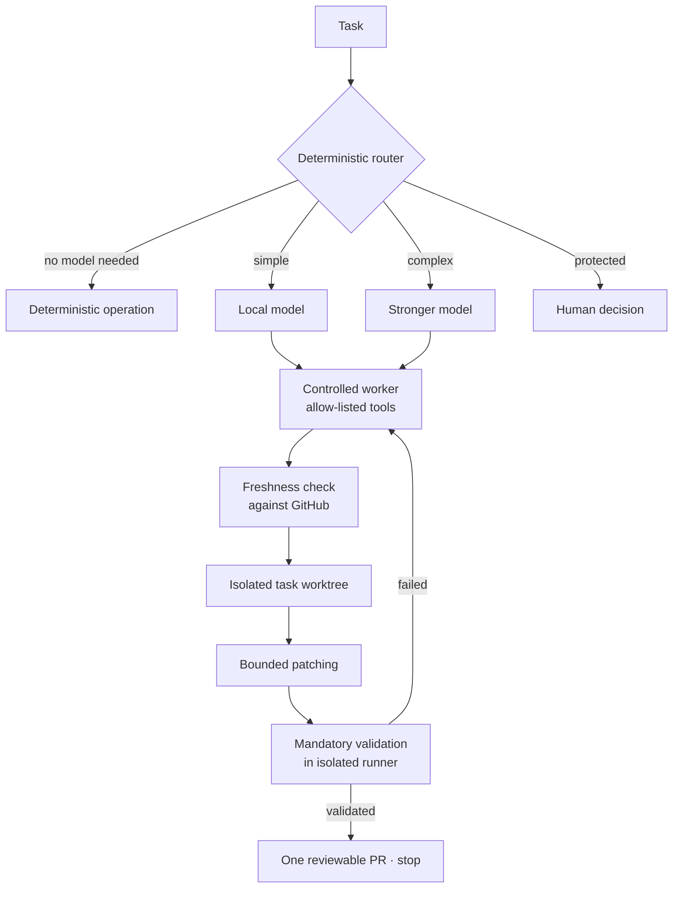

# DevCore: prototype engine for AI coding tasks

[← Back to profile](../README.md) · [🇧🇷 Português](./pt-br/devcore.md)

| | |
| --- | --- |
| **Role** | Creator: architecture, implementation and tests |
| **Status** | Lab prototype, built in October 2026. Not part of the production workflow; Zayuni is developed through the regular issue → PR → CI → review process. |
| **Stack** | Python 3 · Docker · GitHub REST API · Ollama-compatible local inference · optional strong-model adapter |
| **Evidence** | 141 automated tests passing (`pytest`), 19 test modules |

## Problem

Coding agents are productive when they can read a repository, edit files and run checks. Giving a model an unrestricted shell creates three problems:

- **Safety:** the agent can run destructive commands, push to `main` or touch protected paths.
- **Trust:** the model can claim that "tests pass" without any real check behind it.
- **Cost:** sending every task to the most expensive model wastes money on work that needs no model at all.

## Approach

DevCore **separates reasoning from execution**. The model only proposes actions through a small, allow-listed tool surface. Deterministic components carry out those actions and return structured evidence.

## Key design decisions

- **No unrestricted shell.** Repository reads and searches are bounded, edits go through `apply_patch` inside engine-managed workspaces, and patch size and file count are capped.
- **Fresh source of truth.** Before any editable work, a freshness gate checks the base branch against GitHub, so the agent never builds on stale code.
- **One task, one worktree, one PR.** Each task gets an isolated branch and worktree from a verified base. Delivery commits, pushes and opens a single PR, then stops. DevCore never writes to `main`, merges, deploys or drops databases.
- **Validation the model cannot fake.** Checks are defined in administrator-owned configuration and run by a separate Docker runner against the *modified* workspace. A task is not "done" until `validate_workspace` returns `validated=true`.
- **Cost-aware routing.** A deterministic policy picks the cheapest route that can do the job: no model, local model, stronger model or human. Protected operations always go to a human. When configuration is missing or invalid, routing fails closed.
- **Measurable improvement.** Optional append-only telemetry is privacy-bounded. A replay tool re-evaluates routing policy changes offline against recorded history before they are adopted. Repeated patterns produce *proposals*, never automatic changes.
- **Incident diagnosis.** Sanitized incident bundles are correlated by version and time, with bounded output, to support isolated reproduction.

## Integrations

- **Kanban control plane:** cards assigned to the engine are claimed, heartbeated during execution and handed off to human review.
- **Model backends:** local inference through an Ollama-compatible API, plus an optional strong-model adapter isolated from the host agent's tools.
- **Read-only context:** optional, administrator-authorized notes directory (Markdown/text only).

## What this shows

- Agent architecture: tool design, routing, evaluation and guardrails
- LLM cost and quality trade-offs handled by deterministic policy
- Test discipline: every engine module has its own test suite
