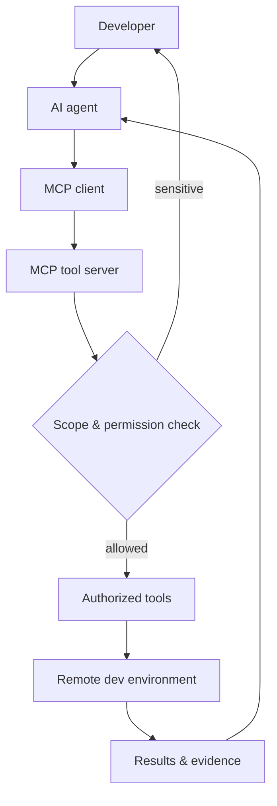

# Zayuni Dev Workspace: MCP tooling for AI agents

[← Back to profile](../README.md) · [🇧🇷 Português](./pt-br/mcp.md)

| | |
| --- | --- |
| **Role** | Design, integration and operation of the workspace |
| **Status** | In use in my own development workflow (private repository) |
| **Stack** | Model Context Protocol (MCP) · Linux · Docker · remote environments |

## Problem

AI agents are most useful when they can read code, run commands and check results in a real environment. Unrestricted access to machines, data or destructive operations is not acceptable, though. The question is how an agent can be productive while every action stays scoped, traceable and reversible.

## Approach

I built an integration based on the **Model Context Protocol (MCP)**, the open standard that connects AI clients to external tools. It exposes a defined set of development tools on remote Linux environments, such as file access, process execution and search, inside configured access boundaries.

*Conceptual diagram; it does not include endpoints or operational configuration.*

## Key design decisions

- **Least privilege:** tools work only inside allowed directories and scopes.
- **Inspect before modify:** agents read the current state before changing it.
- **Human approval for sensitive operations:** merges, deployments, migrations and destructive commands are never implied.
- **Verifiable output:** every task returns evidence, such as command output and test results, that a person can review.
- **Secret hygiene:** credentials and real user data never go into prompts, logs or repositories.

## What this shows

- Practical experience with **MCP**, AI agent tooling and remote Linux operations
- Security thinking applied to agent automation
- An infrastructure that supports the AI-assisted workflow described in [AI-assisted software engineering](./ai-engineering.md)
