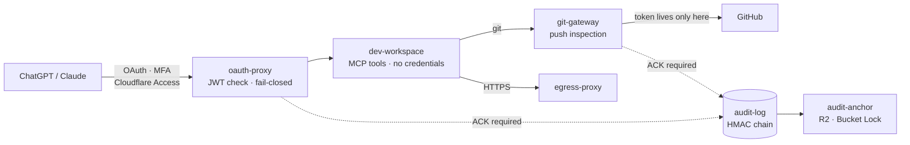

# Zayuni DevWS: my own MCP server for AI agents

[← Back to profile](../README.md) · [🇧🇷 Português](./pt-br/mcp.md) · [▶ The story](https://wesley-isaias.github.io/wesley-isaias/)

| | |
| --- | --- |
| **Role** | Architecture, security design, implementation, tests and operation |
| **Status** | In daily use since November 2026. It is how ChatGPT and Claude work in my repositories. |
| **Stack** | Model Context Protocol (MCP) · Docker Compose (7 services) · Python (standard library only) · Node.js 22 built-ins · Cloudflare Access, Tunnel, Workers and R2 · systemd · GitHub Actions · CircleCI |
| **Evidence** | 81 Git gateway tests, 176 subtests · offline security checks on pull requests · milestone G5: branch, push and PR opened from ChatGPT on a phone, with my computer turned off |

## Problem

I wanted ChatGPT and Claude to work in a real development environment, even from my phone: read code, run commands, open pull requests. That environment must never hold credentials that could damage production, and every action must be attributable afterwards.

The usual setup, an MCP server with a GitHub token inside the container, fails both requirements. A prompt-injected agent could leak the token or push anywhere. Hosted remote-desktop tools also had usage quotas and depended on my PC being on.

## Architecture

*Conceptual view; hostnames, identities and topology are omitted.*

The MCP tools come from the open-source Desktop Commander server, vendored with license notice and SBOM. The security services around it are my own design and implementation.

## Components

**oauth-proxy: identity on every request.**
Cloudflare Access Managed OAuth is the authorization server, restricted to the owner, with TOTP MFA. The proxy validates `Cf-Access-Jwt-Assertion` on every `/mcp` request:
- RS256 only, with keys fetched only from the team's certificate endpoint and a rate-limited refresh for unknown `kid` values
- exact `iss`, single-audience `aud`, at most 60 seconds of clock skew, and an owner identity check
- fail closed when keys are unavailable
- `Authorization`, cookies and `Cf-Access-*` headers are stripped before proxying

**git-gateway: the only route to GitHub.**
The workspace has no GitHub credential. Every clone, fetch and push goes through a gateway that holds the token and allows only three repositories. Each push is indexed into a quarantine with `git index-pack --strict` and checked for fast-forward. Pushes to `main`/`master` and changes under `.github/` are refused. The REST surface allows creating, listing and commenting on pull requests; merge is refused. Pushes are capped at 64 MiB, connections at 16, and every refusal is audited. It has zero third-party dependencies.

**audit-log and audit-anchor: a record that cannot be quietly edited.**
Events follow a closed, content-free schema: no arguments, tokens or raw emails. Each producer connects over its own Unix socket, and the kernel verifies its identity (`SO_PEERCRED` UID/GID). Records are HMAC-chained with monotonic sequence numbers and `fsync`'d. Checkpoints are exported to a private R2 bucket with an indefinite Bucket Lock. If the audit log cannot acknowledge an event, the action does not happen.

**Operations.**
A systemd unit starts the stack only after a boot guard passes. A watchdog checks the seven services and the MCP health endpoint every two minutes and restarts through the guard, at most three times an hour. Images are pinned, and secrets live in per-service files readable only by that service's UID.

## Key design decisions

- **Credentials outside the blast radius:** the agent's container is assumed compromised, so secrets live in separate services.
- **Deny by default, fail closed:** a missing audit acknowledgement, missing keys or unknown configuration all mean "no".
- **Standard library only** for security-critical services, to keep the attack and audit surface small.
- **Staged rollout:** offline implementation and tests, independent review, installation by runbook, then a real-use milestone (G1 → G5) before daily use.

## Known limits

Outbound internet from the workspace is currently open by my decision, pending a security review; the VPS's internal network stays unreachable. Host-level hardening items are tracked as open issues.

## Related

- [DevCore](./devcore.md), a lab prototype that explores the same principles for autonomous coding tasks
- [mcp-secure-gateway](https://github.com/wesley-isaias/mcp-secure-gateway): the same principles in public, runnable code (token auth, rate limiting, HMAC-chained audit log, 59 tests)
