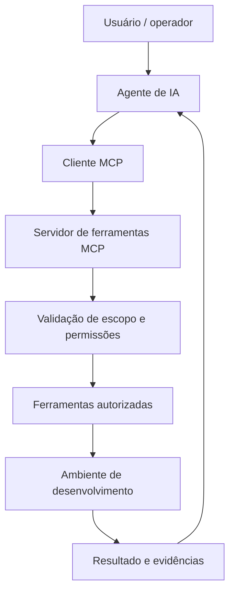

# Zayuni Dev Workspace MCP — ferramentas para agentes de IA

[← Voltar ao perfil](../README.md)

## Problema
Agentes de IA precisam interagir com ambientes de desenvolvimento sem receber acesso irrestrito a máquinas, dados ou operações destrutivas.

## Proposta técnica
Desenvolvimento de integrações baseadas no **Model Context Protocol (MCP)** para expor ferramentas de desenvolvimento a agentes, com escopo de autorização, controles e validação.

## Áreas trabalhadas
- Integração entre agentes e ferramentas de desenvolvimento;
- Operações remotas em ambientes Linux;
- Contêineres e serviços de infraestrutura;
- Testes automatizados e verificação de resultados;
- Segurança, permissões e delimitação de operações.

## Fluxo conceitual

*Diagrama didático de princípios de integração. Não expõe topologia, endpoints ou configuração operacional.*

## Critérios de qualidade
- Privilégios mínimos e autorização explícita para operações sensíveis;
- Inspeção antes de modificação;
- Testes e verificação de saídas;
- Proteção de segredos e dados reais;
- Sem pressupor que um teste local equivale a homologação em produção.

## Evidências e limites
O repositório de infraestrutura é privado. Esta apresentação descreve o domínio de engenharia e os objetivos técnicos, sem divulgar credenciais, rotas internas ou dados operacionais.
