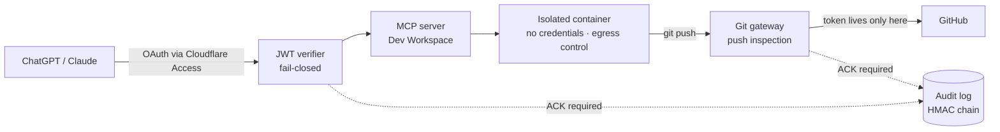

# Zayuni Dev Workspace: secure MCP access for AI agents

[← Back to profile](../README.md) · [🇧🇷 Português](./pt-br/mcp.md)

| | |
| --- | --- |
| **Role** | Architecture, security design, implementation and tests |
| **Status** | MCP gateway v0.6 in operation with 14 declared tools. The Dev Workspace security layer is implemented and tested offline and goes through an independent security review before installation. |
| **Stack** | Model Context Protocol (MCP) · Python (standard library only) · Node.js 22 built-ins · Docker · Cloudflare Access · GitHub Actions · CircleCI |
| **Evidence** | 81 Git gateway tests, 176 subtests · offline security checks on pull requests |

## Problem

I wanted ChatGPT and Claude to work in a real development container: read code, run commands, open pull requests. The container must never hold credentials that could damage production, and every action must be attributable after the fact.

The usual setup, an MCP server with a GitHub token inside the container, fails both requirements. A prompt-injected agent could leak the token or push anywhere.

## Architecture

*Conceptual view; hostnames, identities and topology are omitted.*

The MCP tool layer builds on the open-source Desktop Commander server, vendored with notice and SBOM. The components below are my own design and implementation.

## Components

**Git gateway: the only route to GitHub.**
The workspace has no GitHub credential. Every clone, fetch and push goes through a gateway that holds the token. Each push is indexed into a quarantine with `git index-pack --strict`, checked for fast-forward, and every changed path in the range is compared against protected-path rules before anything is forwarded. A minimal REST surface allows creating, listing and commenting on PRs, and nothing more. It has zero third-party dependencies, so there is no supply chain to audit.

**JWT verifier in front of `/mcp`.**
Cloudflare Access Managed OAuth is the authorization server, and the origin validates `Cf-Access-Jwt-Assertion` on every request:
- RS256 only, with keys fetched only from the team's certificate endpoint and a rate-limited refresh for unknown `kid` values
- exact `iss`, single-audience `aud`, at most 60 seconds of clock skew, and an owner identity check
- fail closed when keys are unavailable
- `Authorization`, cookies and `Cf-Access-*` headers are stripped before proxying

**Tamper-evident audit log.**
Events follow a closed, content-free schema: no arguments, tokens or raw emails. Each producer connects over its own Unix socket, and the kernel verifies its identity (`SO_PEERCRED` UID/GID). Records are HMAC-chained with monotonic sequence numbers and `fsync`'d. Periodic checkpoints go to an independent anchor. If the audit log cannot ACK, the action does not happen.

**Guarded activation.**
Tools that start real work stay disabled by a protection overlay until human authentication bound to the task, idempotency and audit integration are in place.

## Key design decisions

- **Credentials outside the blast radius:** the agent's container is assumed compromised, so secrets live in separate services.
- **Deny by default, fail closed:** a missing audit log, missing keys or unknown configuration all mean "no".
- **Standard library only** for security-critical services, to keep the attack and audit surface small.
- **Security review before installation:** offline implementation, tests and an independent review come before any deployment.

## Related

- [DevCore](./devcore.md), the execution engine that applies the same principles to autonomous coding tasks
- [Public example: deny-by-default tool authorization](../examples/agent-policy/README.md)
