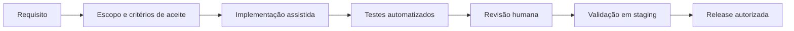

# Engenharia de software assistida por IA

[← Voltar ao perfil](../../README.pt-BR.md) · [🇺🇸 English](../ai-engineering.md)

| | |
| --- | --- |
| **Foco** | Usar agentes de IA para entregar mais rápido sem reduzir o padrão de engenharia |
| **Ferramentas** | Agentes de código · MCP · inferência com LLMs locais · GitHub · CI (GitHub Actions, CircleCI) |

## Abordagem

Trato agentes de IA como parte de um processo de engenharia controlado, não como substitutos dele. Toda tarefa de um agente começa com um requisito claro e termina com evidências que uma pessoa pode revisar.

## Práticas

1. **Planejamento:** dividir problemas em mudanças pequenas e revisáveis, com critérios de aceite explícitos.
2. **Execução assistida:** conectar agentes a repositórios e ferramentas autorizadas via MCP.
3. **Modelos locais:** usar inferência local quando privacidade ou custo exigem.
4. **Portões de qualidade:** lint, checagem de tipos, testes e build rodam primeiro localmente; a CI confirma o commit final.
5. **CI com custo controlado:** agrupar pushes, evitar execuções redundantes e reservar pipelines pesados para os commits que precisam deles, sem remover checks obrigatórios.
6. **Controle de release:** merge, deploy e migração exigem aprovação explícita; testes locais não substituem a validação em staging.

## Princípios

- Resultado de IA só é confiável depois de verificado.
- Resultados devem ser reproduzíveis e revisáveis.
- Dados de usuários permanecem íntegros e isolados.
- Métricas só são publicadas quando há evidências que as sustentem.
