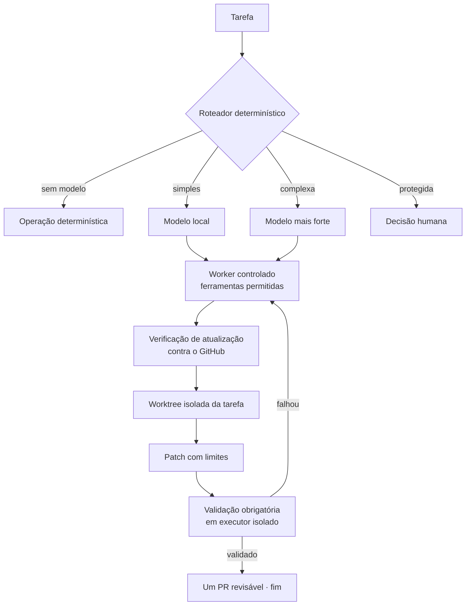

# DevCore: protótipo de motor para tarefas de código com IA

[← Voltar ao perfil](../../README.pt-BR.md) · [🇺🇸 English](../devcore.md)

| | |
| --- | --- |
| **Papel** | Criador: arquitetura, implementação e testes |
| **Status** | Protótipo de laboratório, construído em outubro de 2026. Não faz parte do fluxo de produção; o Zayuni é desenvolvido pelo processo normal de issue → PR → CI → revisão. |
| **Tecnologias** | Python 3 · Docker · API REST do GitHub · inferência local compatível com Ollama · adaptador opcional para modelo mais forte |
| **Evidências** | 141 testes automatizados passando (`pytest`), 19 módulos de teste |

## Problema

Agentes de código são produtivos quando conseguem ler um repositório, editar arquivos e rodar verificações. Dar ao modelo um shell irrestrito cria três problemas:

- **Segurança:** o agente pode executar comandos destrutivos, enviar direto para a `main` ou alterar caminhos protegidos.
- **Confiança:** o modelo pode afirmar que "os testes passam" sem nenhuma verificação real.
- **Custo:** mandar toda tarefa para o modelo mais caro desperdiça dinheiro em trabalho que nem precisa de modelo.

## Abordagem

O DevCore **separa raciocínio de execução**. O modelo apenas propõe ações por meio de um conjunto pequeno e restrito de ferramentas. Componentes determinísticos executam essas ações e devolvem evidências estruturadas.

## Principais decisões de design

- **Sem shell irrestrito.** Leituras e buscas no repositório têm limites, edições passam por `apply_patch` em workspaces gerenciados, e tamanho e quantidade de arquivos por patch são limitados.
- **Fonte de verdade atualizada.** Antes de qualquer edição, uma verificação compara o branch base com o GitHub, para que o agente nunca trabalhe sobre código desatualizado.
- **Uma tarefa, uma worktree, um PR.** Cada tarefa recebe branch e worktree isolados a partir de uma base verificada. A entrega faz commit, push e abre um único PR, e então para. O DevCore nunca escreve na `main`, não faz merge, não faz deploy e não apaga bancos.
- **Validação que o modelo não consegue falsificar.** As verificações são definidas em configuração do administrador e executadas por um executor Docker separado, sobre o workspace *modificado*. A tarefa só está pronta quando `validate_workspace` retorna `validated=true`.
- **Roteamento por custo.** Uma política determinística escolhe a rota mais barata capaz de resolver a tarefa: sem modelo, modelo local, modelo mais forte ou humano. Operações protegidas sempre vão para um humano. Com configuração ausente ou inválida, o roteamento falha fechado.
- **Melhoria mensurável.** A telemetria opcional é append-only e limitada por privacidade. Uma ferramenta de replay reavalia mudanças de política de roteamento offline, contra o histórico registrado, antes de adotá-las. Padrões repetidos geram *propostas*, nunca mudanças automáticas.
- **Diagnóstico de incidentes.** Pacotes de incidentes sanitizados são correlacionados por versão e horário, com saída limitada, para apoiar a reprodução isolada.

## Integrações

- **Kanban como plano de controle:** cartões atribuídos ao motor são assumidos, recebem heartbeat durante a execução e são entregues para revisão humana.
- **Backends de modelo:** inferência local por API compatível com Ollama, além de um adaptador opcional para modelo mais forte, isolado das ferramentas do agente hospedeiro.
- **Contexto somente leitura:** diretório opcional de notas autorizado pelo administrador (apenas Markdown/texto).

## O que este projeto demonstra

- Arquitetura de agentes: desenho de ferramentas, roteamento, avaliação e controles
- Equilíbrio entre custo e qualidade de LLMs resolvido por política determinística
- Disciplina de testes: cada módulo do motor tem sua própria suíte
