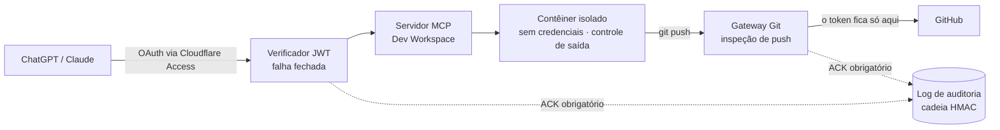

# Zayuni Dev Workspace: acesso MCP seguro para agentes de IA

[← Voltar ao perfil](../../README.pt-BR.md) · [🇺🇸 English](../mcp.md)

| | |
| --- | --- |
| **Papel** | Arquitetura, desenho de segurança, implementação e testes |
| **Status** | Gateway MCP v0.6 em operação, com 14 ferramentas declaradas. A camada de segurança do Dev Workspace está implementada e testada offline e passa por revisão de segurança independente antes da instalação. |
| **Tecnologias** | Model Context Protocol (MCP) · Python (só biblioteca padrão) · módulos nativos do Node.js 22 · Docker · Cloudflare Access · GitHub Actions · CircleCI |
| **Evidências** | 81 testes do gateway Git, 176 subtestes · checks de segurança offline nos pull requests |

## Problema

Eu queria que o ChatGPT e o Claude trabalhassem em um contêiner de desenvolvimento real: ler código, executar comandos, abrir pull requests. Esse contêiner nunca pode ter credenciais capazes de danificar a produção, e toda ação precisa ser atribuível depois.

A configuração comum, um servidor MCP com um token do GitHub dentro do contêiner, falha nos dois requisitos. Um agente vítima de prompt injection poderia vazar o token ou fazer push em qualquer lugar.

## Arquitetura

*Visão conceitual; hostnames, identidades e topologia foram omitidos.*

A camada de ferramentas MCP usa como base o servidor open-source Desktop Commander, incorporado com aviso de licença e SBOM. Os componentes abaixo são de desenho e implementação próprios.

## Componentes

**Gateway Git: o único caminho até o GitHub.**
O workspace não tem credencial do GitHub. Todo clone, fetch e push passa por um gateway que guarda o token. Cada push é indexado em quarentena com `git index-pack --strict`, verificado como fast-forward, e cada caminho alterado no intervalo é comparado com as regras de caminhos protegidos antes de qualquer encaminhamento. Uma API REST mínima permite criar, listar e comentar PRs, e nada além disso. Ele não tem nenhuma dependência de terceiros, então não há cadeia de suprimentos a auditar.

**Verificador JWT na frente do `/mcp`.**
O Cloudflare Access Managed OAuth é o servidor de autorização, e a origem valida o `Cf-Access-Jwt-Assertion` em toda requisição:
- apenas RS256, com chaves buscadas somente no endpoint de certificados do time e atualização limitada para `kid` desconhecido
- `iss` exato, `aud` com uma única audiência, no máximo 60 segundos de diferença de relógio e verificação da identidade do dono
- falha fechada quando as chaves não estão disponíveis
- cabeçalhos `Authorization`, cookies e `Cf-Access-*` são removidos antes do proxy

**Log de auditoria à prova de adulteração.**
Os eventos seguem um esquema fechado e sem conteúdo: nada de argumentos, tokens ou e-mails em texto puro. Cada produtor conecta por um socket Unix próprio, e o kernel verifica sua identidade (UID/GID via `SO_PEERCRED`). Os registros são encadeados por HMAC, com sequência monotônica e `fsync`. Checkpoints periódicos vão para uma âncora independente. Se o log de auditoria não confirmar (ACK), a ação não acontece.

**Ativação protegida.**
Ferramentas que iniciam trabalho real ficam desabilitadas por uma camada de proteção até existirem autenticação humana vinculada à tarefa, idempotência e integração com a auditoria.

## Principais decisões de design

- **Credenciais fora do raio de impacto:** o contêiner do agente é tratado como comprometido, então os segredos ficam em serviços separados.
- **Negar por padrão, falhar fechado:** log de auditoria ausente, chaves indisponíveis ou configuração desconhecida significam "não".
- **Só biblioteca padrão** nos serviços críticos de segurança, para manter pequena a superfície de ataque e de auditoria.
- **Revisão de segurança antes da instalação:** implementação offline, testes e revisão independente vêm antes de qualquer deploy.

## Relacionados

- [DevCore](./devcore.md), o motor de execução que aplica os mesmos princípios a tarefas autônomas de código
- [Exemplo público: autorização de ferramentas com negação por padrão](../../examples/agent-policy/README.md)
