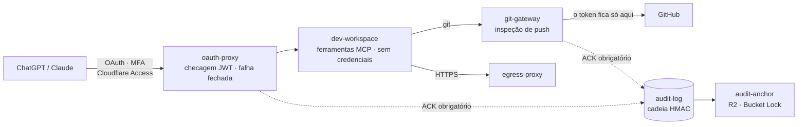

# Zayuni DevWS: meu próprio servidor MCP para agentes de IA

[← Voltar ao perfil](../../README.pt-BR.md) · [🇺🇸 English](../mcp.md) · [▶ A história](https://wesley-isaias.github.io/wesley-isaias/)

| | |
| --- | --- |
| **Papel** | Arquitetura, desenho de segurança, implementação, testes e operação |
| **Status** | Em uso diário desde novembro de 2026. É por ele que o ChatGPT e o Claude trabalham nos meus repositórios. |
| **Tecnologias** | Model Context Protocol (MCP) · Docker Compose (7 serviços) · Python (só biblioteca padrão) · módulos nativos do Node.js 22 · Cloudflare Access, Tunnel, Workers e R2 · systemd · GitHub Actions · CircleCI |
| **Evidências** | 81 testes do gateway Git, 176 subtestes · checks de segurança offline nos pull requests · marco G5: branch, push e PR abertos pelo ChatGPT no celular, com o computador desligado |

## Problema

Eu queria que o ChatGPT e o Claude trabalhassem num ambiente de desenvolvimento real, inclusive pelo celular: ler código, executar comandos, abrir pull requests. Esse ambiente nunca pode ter credenciais capazes de danificar a produção, e toda ação precisa ser atribuível depois.

A configuração comum, um servidor MCP com um token do GitHub dentro do contêiner, falha nos dois requisitos. Um agente vítima de prompt injection poderia vazar o token ou fazer push em qualquer lugar. As ferramentas de acesso remoto hospedadas ainda tinham cota de uso e dependiam do meu PC ligado.

## Arquitetura

*Visão conceitual; hostnames, identidades e topologia foram omitidos.*

As ferramentas MCP vêm do servidor open-source Desktop Commander, incorporado com aviso de licença e SBOM. Os serviços de segurança em volta dele são de desenho e implementação próprios.

## Componentes

**oauth-proxy: identidade em toda requisição.**
O Cloudflare Access Managed OAuth é o servidor de autorização, restrito ao dono, com MFA por TOTP. O proxy valida o `Cf-Access-Jwt-Assertion` em toda requisição `/mcp`:
- apenas RS256, com chaves buscadas somente no endpoint de certificados do time e atualização limitada para `kid` desconhecido
- `iss` exato, `aud` com uma única audiência, no máximo 60 segundos de diferença de relógio e verificação da identidade do dono
- falha fechada quando as chaves não estão disponíveis
- cabeçalhos `Authorization`, cookies e `Cf-Access-*` são removidos antes do proxy

**git-gateway: o único caminho até o GitHub.**
O workspace não tem credencial do GitHub. Todo clone, fetch e push passa por um gateway que guarda o token e só permite três repositórios. Cada push é indexado em quarentena com `git index-pack --strict` e verificado como fast-forward. Push em `main`/`master` e mudanças em `.github/` são recusados. A API REST permite criar, listar e comentar pull requests; merge é recusado. O push é limitado a 64 MiB, as conexões a 16, e toda recusa é auditada. Ele não tem nenhuma dependência de terceiros.

**audit-log e audit-anchor: um registro que não pode ser alterado em silêncio.**
Os eventos seguem um esquema fechado e sem conteúdo: nada de argumentos, tokens ou e-mails em texto puro. Cada produtor conecta por um socket Unix próprio, e o kernel verifica sua identidade (UID/GID via `SO_PEERCRED`). Os registros são encadeados por HMAC, com sequência monotônica e `fsync`. Checkpoints são exportados para um bucket R2 privado com Bucket Lock por tempo indeterminado. Se o log de auditoria não confirmar o evento, a ação não acontece.

**Operação.**
Uma unidade systemd só sobe a pilha depois que uma verificação de boot passa. Um watchdog confere os sete serviços e o endpoint de saúde do MCP a cada dois minutos e reinicia pela mesma verificação, no máximo três vezes por hora. As imagens são fixadas, e os segredos ficam em arquivos por serviço, legíveis apenas pelo UID daquele serviço.

## Principais decisões de design

- **Credenciais fora do raio de impacto:** o contêiner do agente é tratado como comprometido, então os segredos ficam em serviços separados.
- **Negar por padrão, falhar fechado:** confirmação de auditoria ausente, chaves indisponíveis ou configuração desconhecida significam "não".
- **Só biblioteca padrão** nos serviços críticos de segurança, para manter pequena a superfície de ataque e de auditoria.
- **Implantação por etapas:** implementação offline e testes, revisão independente, instalação por roteiro e um marco de uso real (G1 → G5) antes do uso diário.

## Limites conhecidos

A saída para a internet a partir do workspace está aberta hoje, por decisão minha, até uma revisão de segurança; a rede interna da VPS continua inacessível. Itens de endurecimento do host estão registrados como pendências.

## Relacionados

- [DevCore](./devcore.md), um protótipo de laboratório que explora os mesmos princípios em tarefas autônomas de código
- [Exemplo público: autorização de ferramentas com negação por padrão](../../examples/agent-policy/README.md)
