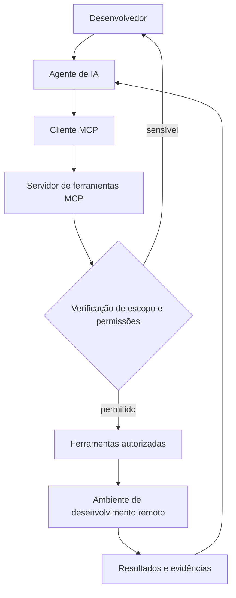

# Zayuni Dev Workspace: ferramentas MCP para agentes de IA

[← Voltar ao perfil](../../README.pt-BR.md) · [🇺🇸 English](../mcp.md)

| | |
| --- | --- |
| **Papel** | Concepção, integração e operação do workspace |
| **Status** | Em uso no meu fluxo de desenvolvimento (repositório privado) |
| **Tecnologias** | Model Context Protocol (MCP) · Linux · Docker · ambientes remotos |

## Problema

Agentes de IA são mais úteis quando conseguem ler código, executar comandos e verificar resultados em um ambiente real. Mas acesso irrestrito a máquinas, dados ou operações destrutivas não é aceitável. A questão é como tornar o agente produtivo mantendo cada ação delimitada, rastreável e reversível.

## Abordagem

Construí uma integração baseada no **Model Context Protocol (MCP)**, o padrão aberto que conecta clientes de IA a ferramentas externas. Ela expõe um conjunto definido de ferramentas de desenvolvimento em ambientes Linux remotos, como acesso a arquivos, execução de processos e busca, dentro de limites de acesso configurados.

*Diagrama conceitual; não inclui endpoints nem configuração operacional.*

## Principais decisões de design

- **Privilégio mínimo:** as ferramentas atuam apenas dentro de diretórios e escopos permitidos.
- **Inspecionar antes de modificar:** o agente lê o estado atual antes de alterá-lo.
- **Aprovação humana para operações sensíveis:** merge, deploy, migração e comandos destrutivos nunca são implícitos.
- **Resultados verificáveis:** cada tarefa devolve evidências, como saída de comandos e resultados de testes, que uma pessoa pode revisar.
- **Proteção de segredos:** credenciais e dados reais de usuários nunca vão para prompts, logs ou repositórios.

## O que este projeto demonstra

- Experiência prática com **MCP**, ferramentas para agentes de IA e operação de ambientes Linux remotos
- Pensamento de segurança aplicado à automação com agentes
- A infraestrutura que sustenta o fluxo descrito em [Engenharia de software assistida por IA](./ai-engineering.md)
