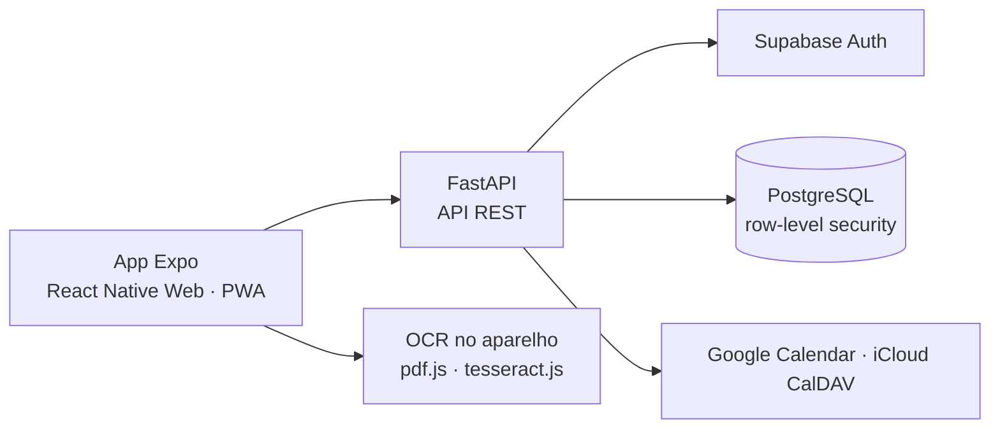

# Zayuni: gestão de consultório para profissionais de saúde

[← Voltar ao perfil](../../README.pt-BR.md) · [🇺🇸 English](../zayuni.md) · [▶ A história](https://wesley-isaias.github.io/wesley-isaias/)

| | |
| --- | --- |
| **Papel** | Criador: produto, arquitetura, front-end, back-end, dados e releases |
| **Status** | Em desenvolvimento ativo · [app.zayuni.com](https://app.zayuni.com) (requer login) |
| **Tecnologias** | Expo · React Native Web · Expo Router · PWA · Python · FastAPI · Supabase (Auth, PostgreSQL, row-level security) · Docker · Google Cloud Run · Secret Manager |
| **Evidências** | 425 testes de backend passando (`pytest`) · 43 arquivos de teste no front-end · 51 migrações SQL · 442 commits desde setembro de 2026 |

## Problema

Profissionais de saúde autônomos e pequenas clínicas costumam controlar a agenda num caderno, os pacientes numa planilha e os pagamentos em conversas de WhatsApp. Informações se perdem, horários se sobrepõem, e no fim do mês ninguém sabe o que de fato foi recebido.

## O que construí

Um app para o dia de trabalho, no celular, no tablet e no computador:

- **Agenda:** atendimentos, modelos de disponibilidade semanal e catálogo de serviços
- **Pacientes:** cadastro, busca e histórico de atendimentos, restritos à conta do profissional
- **Financeiro:** cobranças, pacotes de serviços, lembretes de pagamento, comprovantes e CPF/CNPJ
- **Painel:** números diários e mensais do consultório
- **Sincronização de agenda:** atendimentos sincronizados com Google Calendar (OAuth) e iCloud (CalDAV)

## Arquitetura

*Visão simplificada; não mostra a topologia exata de produção.*

## Decisões de engenharia

**Isolamento por conta no banco.** Toda consulta carrega o escopo de organização e usuário, e a row-level security do PostgreSQL garante isso na camada de dados. Um erro na interface não consegue expor pacientes de outro consultório.

**Comprovantes lidos no próprio aparelho.** Quando o paciente envia um comprovante Pix em PDF ou imagem, o aparelho do profissional faz a leitura por OCR (pdf.js e tesseract.js). O arquivo nunca chega ao servidor: só os campos extraídos (valor, data, pagador, chave do recebedor e o EndToEndId do Pix), e um algoritmo determinístico sugere quem pagou. Como comprovante não é prova de pagamento, o profissional confirma no banco antes de qualquer registro. Os arquivos do OCR são hospedados pelo próprio app e fixados por hash, então uma mudança em CDN não consegue alterá-los. O leitor também lida com chaves mascaradas ou danificadas pelo OCR, como `•••.982.247-••`.

**Pix sem intermediário.** As cobranças Pix são geradas como BR Code padrão, com validação de chave por e-mail, telefone, CPF/CNPJ e chave aleatória.

**Provedores de agenda atrás de uma fronteira.** Os atendimentos pertencem ao núcleo do Zayuni. Os provedores recebem apenas uma projeção mínima e neutra do evento, e os tokens OAuth e credenciais ficam criptografados.

**Produção protegida.** Merge na `main` publica em staging. Produção é uma promoção separada e explícita pelo Cloud Build. Workflows de regressão dedicados protegem áreas críticas: fuso horário da agenda, comprovantes do financeiro e busca de pacientes.

## Construído com agentes de IA

O Zayuni é desenvolvido com agentes de IA trabalhando pelo [workspace MCP](./mcp.md) e pelo [DevCore](./devcore.md). Os agentes trabalham em branches de funcionalidade. Toda mudança passa por testes, CI e revisão humana, e nada chega à produção sem uma promoção explícita.

## Próximos passos

- Demonstração pública com dados fictícios
- Vídeo curto dos fluxos principais
