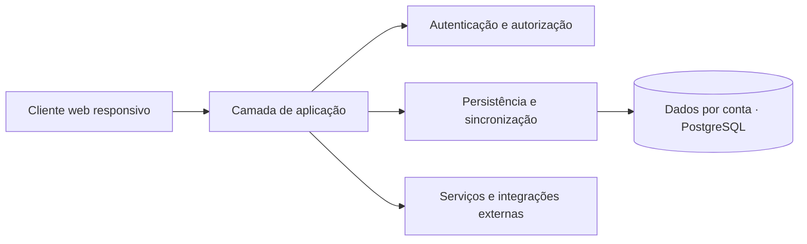

# Zayuni: SaaS para profissionais de saúde

[← Voltar ao perfil](../../README.pt-BR.md) · [🇺🇸 English](../zayuni.md)

| | |
| --- | --- |
| **Papel** | Desenvolvimento do produto: arquitetura, front-end, dados e releases |
| **Status** | Em desenvolvimento ativo · [app.zayuni.com](https://app.zayuni.com) (requer login) |
| **Tecnologias** | Aplicação web responsiva · Supabase (PostgreSQL, Auth) · Git/GitHub com staging e produção |

## Problema

Profissionais de saúde autônomos costumam administrar o consultório entre cadernos, planilhas e aplicativos de mensagem. Agenda, histórico de pacientes e pagamentos ficam em lugares diferentes, o que gera erros de agendamento, perda de informações e pouca visibilidade financeira.

## O que estou construindo

Uma única plataforma para a rotina do consultório:

- **Agenda:** horários, disponibilidade e tipos de serviço
- **Pacientes:** cadastro e histórico de atendimentos vinculados à conta do profissional
- **Atendimentos:** registro rápido durante o dia de trabalho
- **Financeiro:** acompanhamento de receitas e pagamentos por serviço

A interface foi pensada para celular, tablet e computador, já que o profissional alterna entre dispositivos ao longo do dia.

## Arquitetura

*Visão simplificada; não mostra a topologia exata de produção.*

## Desafios e decisões de engenharia

**Consistência entre dispositivos.** Quando o mesmo registro é editado em mais de um dispositivo, uma atualização não pode sobrescrever dados válidos. Projetei os fluxos de persistência e sincronização para que cada alteração seja aplicada de forma intencional, sem substituições silenciosas.

**Isolamento e privacidade.** Cada registro pertence a uma conta, e as regras de acesso são aplicadas na camada de dados, não apenas na interface. Informações de saúde são tratadas como dados sensíveis.

**Entrega incremental e segura.** Staging e produção são separados. As mudanças são validadas em staging antes da liberação, e alterações de banco são planejadas para ser reversíveis.

**Experiência sem atrito.** Removi etapas desnecessárias dos fluxos de cadastro, agenda e atendimento para que a ferramenta se encaixe em uma rotina clínica corrida.

## Próximos passos

- Demonstração pública com dados fictícios
- Capturas de tela e um vídeo curto dos fluxos principais
