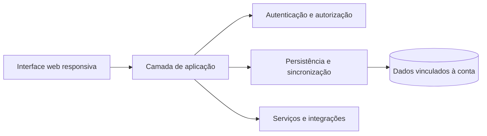

# Zayuni — SaaS para profissionais de saúde

[← Voltar ao perfil](../README.md)

## Contexto
Produto digital em desenvolvimento para organizar a rotina de profissionais de saúde, incluindo agenda, pacientes, serviços, atendimentos e gestão financeira.

## Meu trabalho
- Estruturação e evolução de fluxos de produto;
- Interfaces responsivas para celular, tablet e computador;
- Integrações e persistência de dados;
- Regras de acesso e privacidade de informações;
- Testes, revisão e homologação de alterações.

## Desafios de engenharia
**Consistência de dados:** garantir que atualizações entre dispositivos não sobrescrevam informações válidas.

**Segurança e isolamento:** manter dados vinculados à conta correta e proteger informações sensíveis.

**Evolução incremental:** separar staging de produção e validar mudanças antes da liberação.

**Experiência do usuário:** reduzir etapas desnecessárias em cadastro, agenda e atendimento.

## Arquitetura conceitual

*Diagrama conceitual, não representação exata da infraestrutura privada.*

## Evidências e limites
- Site do produto: [app.zayuni.com](https://app.zayuni.com) (pode exigir autenticação).
- Código-fonte e dados de clientes não são públicos.
- Funcionalidades descritas representam escopo do produto em desenvolvimento; não se afirma que todas estão liberadas em produção.

## Próximas evidências públicas
Capturas com dados fictícios, demonstração autorizada e decisões técnicas revisadas.
