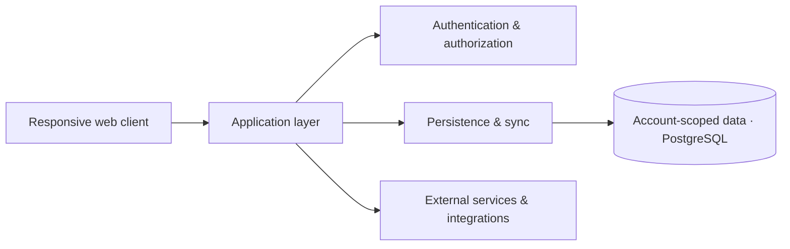

# Zayuni: SaaS for healthcare professionals

[← Back to profile](../README.md) · [🇧🇷 Português](./pt-br/zayuni.md)

| | |
| --- | --- |
| **Role** | Product development: architecture, front-end, data and releases |
| **Status** | In active development · [app.zayuni.com](https://app.zayuni.com) (sign-in required) |
| **Stack** | Responsive web app · Supabase (PostgreSQL, Auth) · Git/GitHub with staging and production |

## Problem

Independent healthcare professionals often run their practice across paper notebooks, spreadsheets and messaging apps. Appointments, patient history and payments end up in different places, which leads to scheduling errors, lost information and little financial visibility.

## What I'm building

One platform that covers the daily routine of a practice:

- **Scheduling:** appointments, availability and service types
- **Patients:** records and care history linked to the professional's account
- **Appointments:** fast registration flows during the working day
- **Finance:** revenue and payment tracking per service

The interface is designed for phone, tablet and desktop, since professionals switch devices during the day.

## Architecture

*Simplified view; it does not show the exact production topology.*

## Engineering challenges and decisions

**Multi-device consistency.** When the same record is edited on more than one device, updates must not overwrite valid data. I designed the persistence and sync flows so that each change is applied on purpose and never silently replaced.

**Tenant isolation and privacy.** Every record belongs to one account, and access rules are enforced in the data layer, not only in the UI. Health-related information is handled as sensitive data.

**Safe, incremental delivery.** Staging and production are separate. Changes are validated in staging before release, and database changes are planned to be reversible.

**Low-friction UX.** I cut unnecessary steps from registration, scheduling and appointment flows so the tool fits a busy clinical routine.

## Next milestones

- Public demo with fictional data
- Screenshots and a short walkthrough of the main flows
