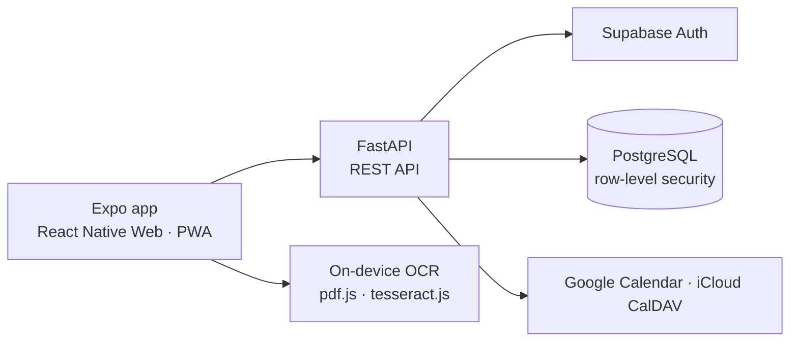

# Zayuni: practice management for health professionals

[← Back to profile](../README.md) · [🇧🇷 Português](./pt-br/zayuni.md) · [▶ The story](https://wesley-isaias.github.io/wesley-isaias/)

| | |
| --- | --- |
| **Role** | Creator: product, architecture, front-end, back-end, data and releases |
| **Status** | In active development · [app.zayuni.com](https://app.zayuni.com) (sign-in required) |
| **Stack** | Expo · React Native Web · Expo Router · PWA · Python · FastAPI · Supabase (Auth, PostgreSQL, row-level security) · Docker · Google Cloud Run · Secret Manager |
| **Evidence** | 425 backend tests passing (`pytest`) · 43 front-end test files · 51 SQL migrations · 442 commits since September 2026 |

## Problem

Independent health professionals and small clinics often keep appointments in a notebook, patients in a spreadsheet and payments in WhatsApp chats. Information gets lost, double bookings happen, and nobody knows what was actually received at the end of the month.

## What I built

One app for the working day, on phone, tablet and desktop:

- **Schedule:** appointments, weekly availability presets and a service catalog
- **Patients:** records, search and care history scoped to the professional's account
- **Finance:** charges, service packages, payment reminders, receipts and tax IDs (CPF/CNPJ)
- **Dashboard:** daily and monthly figures for the practice
- **Calendar sync:** appointments sync to Google Calendar (OAuth) and iCloud (CalDAV)

## Architecture

*Simplified view; it does not show the exact production topology.*

## Engineering decisions

**Tenant isolation in the database.** Every query carries an organization and user scope, and PostgreSQL row-level security enforces it in the data layer. A bug in the UI cannot expose another practice's patients.

**Payment receipts read on the device.** When a patient sends a Pix receipt as a PDF or image, the professional's device reads it with OCR (pdf.js and tesseract.js). The file never reaches the server: only the extracted fields do (amount, date, payer, payee key and the Pix EndToEndId), and a deterministic matcher suggests who paid. A receipt is not proof of payment, so the professional confirms against the bank before anything is recorded. The OCR assets are self-hosted and pinned by hash, so a CDN change cannot alter them. The parser also handles masked or OCR-damaged keys such as `•••.982.247-••`.

**Pix without an intermediary.** Pix charges are generated as standard BR Codes, with key validation for e-mail, phone, CPF/CNPJ and random keys.

**Calendar providers behind a boundary.** Appointments belong to the Zayuni core. Providers only receive a minimal, provider-neutral event projection, and their OAuth refresh tokens and credentials are encrypted at rest.

**Protected production.** Merging to `main` deploys to staging. Production is a separate, explicit promotion through Cloud Build. Dedicated regression workflows guard critical areas: agenda time zones, finance receipts and patient search.

## Built with AI agents

Zayuni is developed with AI coding agents working through the [MCP workspace](./mcp.md) and [DevCore](./devcore.md). Agents work on feature branches. Every change goes through tests, CI and human review, and nothing reaches production without an explicit promotion.

## Next milestones

- Public demo with fictional data
- Short walkthrough video of the main flows
